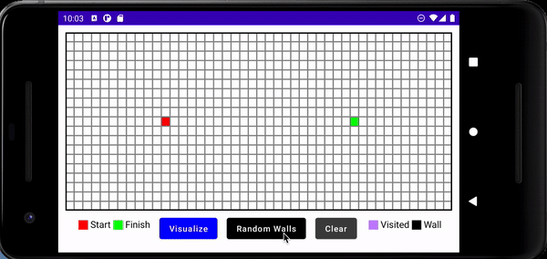
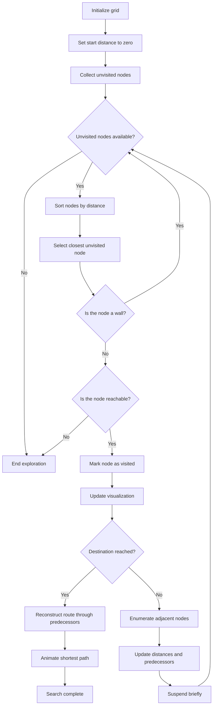
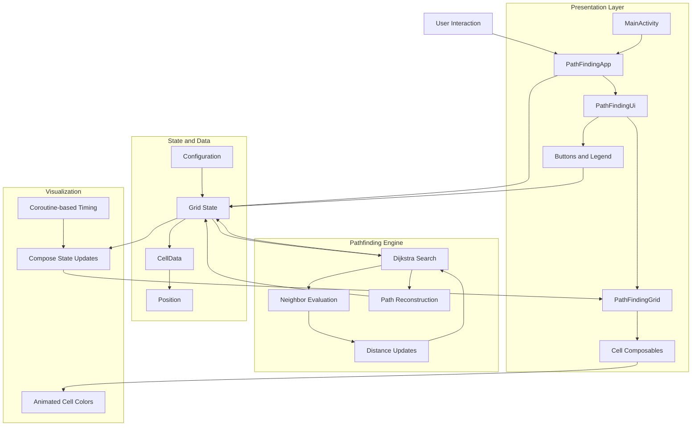
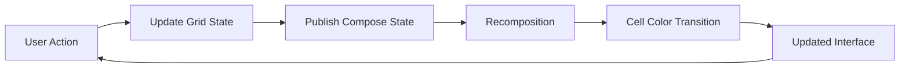
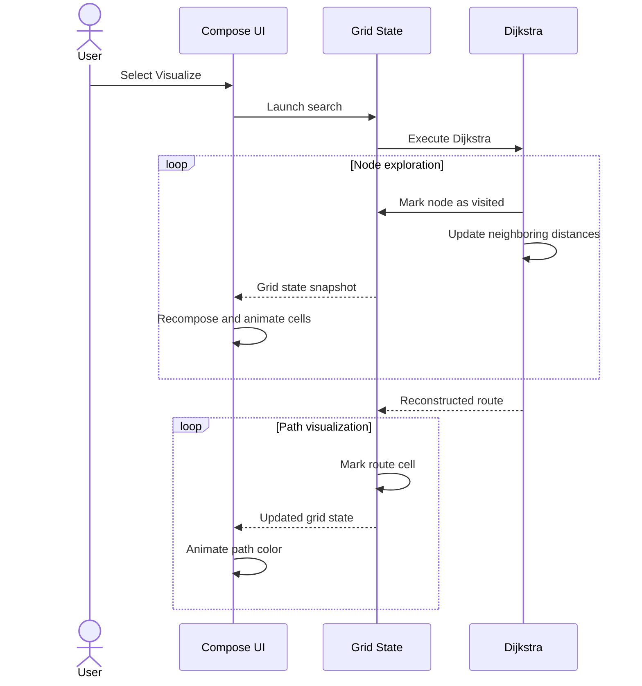

<div align="center">

  <h1>Pathfinding Visualizer</h1>

  <p>
    <strong>Making algorithms visible, interactive, and intuitive.</strong>
  </p>

  <p>
    A native Android application exploring graph traversal,
    shortest-path algorithms, and interactive algorithm visualization
    through Kotlin and Jetpack Compose.
  </p>

  [](https://developer.android.com/)
  [](https://kotlinlang.org/)
  [](https://developer.android.com/compose)
  [](#pathfinding-engine)
  [](./LICENSE)

  <p>
    <a href="#overview">Overview</a> ·
    <a href="#features">Features</a> ·
    <a href="#pathfinding-engine">Pathfinding</a> ·
    <a href="#architecture">Architecture</a> ·
    <a href="#getting-started">Getting Started</a>
  </p>

  

  <sub>Visual exploration of graph traversal and shortest-path reconstruction.</sub>

</div>

## Overview

Pathfinding Visualizer is a native Android application designed to
make graph search algorithms tangible through interactive
visualization.

The application transforms an abstract mathematical problem into
an interactive spatial experience, allowing users to construct
obstacles, explore different environments, and observe how
Dijkstra's algorithm searches for a route between two points.

Built with Kotlin and Jetpack Compose, the project combines
algorithmic computation with declarative UI, asynchronous execution,
state management, and animated visual feedback.

Rather than displaying only the final result, the application
visualizes the intermediate stages of the search, providing
insight into how individual decisions contribute to the resulting
path.

The project explores several areas of software engineering and
computer science:

- Graph theory and shortest-path problems.
- Interactive algorithm visualization.
- Native Android development.
- Declarative user interfaces.
- Asynchronous programming.
- State-driven UI rendering.
- Computational thinking and visual learning.

## Features

| Feature | Description |
| :--- | :--- |
| **Dijkstra's Algorithm** | Distance-based exploration of a two-dimensional graph. |
| **Interactive Grid** | A 19 × 45 spatial environment containing 855 cells. |
| **Manual Obstacles** | Add or remove walls by interacting directly with individual cells. |
| **Randomized Environments** | Generate different obstacle configurations for experimentation. |
| **Animated Exploration** | Observe visited nodes as the search progresses. |
| **Path Reconstruction** | Visualize the resulting route through animated cell transitions. |
| **Grid Reset** | Restore the initial environment for subsequent experiments. |
| **Declarative UI** | Build the interface using reusable Jetpack Compose components. |
| **Asynchronous Execution** | Coordinate search execution and visualization through Kotlin Coroutines. |

## Pathfinding Engine

### Dijkstra's algorithm

Dijkstra's algorithm is a fundamental graph search algorithm used
to determine shortest paths in graphs with non-negative edge
weights.

In this project, the environment is represented as a two-dimensional
grid, where each traversable cell corresponds to a graph vertex.

Connections between adjacent cells represent valid transitions
with a uniform traversal cost.

The distance relaxation rule is defined as:

$$
d(v) = \min(d(v), d(u) + w(u,v))
$$

Where:

- $d(u)$ represents the accumulated distance to the current node.
- $d(v)$ represents the currently known distance to a neighboring node.
- $w(u,v)$ represents the traversal cost between both nodes.

The current implementation uses a uniform movement cost of one
and supports four-directional navigation.

```text
              North
                ↑
                │
    West ← [ Current ] → East
                │
                ↓
              South
```

Under these movement constraints, Dijkstra's algorithm can
determine a shortest route between reachable endpoints.

### Grid representation

Each cell contains both spatial information and algorithm-specific
state.

| Property | Responsibility |
| :--- | :--- |
| `position` | Row and column coordinates. |
| `type` | Start, finish, wall, or background. |
| `distance` | Accumulated distance from the starting node. |
| `isVisited` | Indicates whether the node has been explored. |
| `isShortestPath` | Indicates whether the node belongs to the reconstructed route. |
| `previousShortestCell` | Reference to the preceding node in the route. |

This representation connects the search algorithm directly to
its visual interpretation.

### Search lifecycle

The following diagram describes the intended execution flow
of Dijkstra's algorithm, including node exploration and
route reconstruction.



The implementation uses a mutable collection of unvisited nodes,
sorting candidates by their accumulated distance during each
iteration.

This straightforward approach favors readability and educational
visualization over search performance optimization.

### Computational considerations

A conventional optimized implementation of Dijkstra's algorithm
typically uses a priority queue, achieving a time complexity of:

$$
O((V + E)\log V)
$$

Where $V$ represents vertices and $E$ represents edges.

The current implementation instead uses repeated sorting and
linear lookups. Consequently, the priority-queue complexity
does not describe its actual performance.

Introducing a more efficient frontier data structure represents
a potential future improvement.

## Architecture

The application is organized around three principal
responsibilities:

- User interaction and declarative rendering.
- Spatial representation and application state.
- Algorithm execution and route reconstruction.

Jetpack Compose provides the presentation layer, while Kotlin
Coroutines coordinate the incremental execution of the search.



### Core components

| Component | Responsibility |
| :--- | :--- |
| `MainActivity` | Android activity lifecycle and Compose initialization. |
| `PathFindingApp` | Coordinates application state, user interaction, and UI updates. |
| `PathFindingUi` | Organizes the grid, controls, and visual legend. |
| `State` | Manages the environment, obstacles, endpoints, and search state. |
| `CellData` | Represents an individual spatial node and its algorithmic properties. |
| `Position` | Encapsulates row and column coordinates. |
| `Dijkstra` | Implements distance-based exploration and route reconstruction. |
| `Config` | Defines grid dimensions, visualization timing, and cell colors. |

## Declarative UI

Jetpack Compose provides a declarative approach to building
the application's visual interface.

Instead of manually updating individual Android views, the
application periodically publishes the current grid state
through Compose's observable state mechanism.

The interface then reflects the latest available cell data.



### UI components

The presentation layer is divided into reusable composables.

| Component | Purpose |
| :--- | :--- |
| `PathFindingGrid` | Displays the spatial environment using `LazyVerticalGrid`. |
| `Cell` | Renders an individual interactive grid cell. |
| `VisualizeButton` | Initiates algorithm execution. |
| `RandomWallsButton` | Generates randomized obstacles. |
| `ClearButton` | Restores the initial grid. |
| `Legend` | Explains the visual meaning of cell colors. |

### State-driven animations

Cell transitions are animated using Compose's
`animateColorAsState` API.

```kotlin
val bgColor = animateColorAsState(
    targetValue = getBackgroundByType(cellData),
    animationSpec = tween(durationMillis = 700)
)
```

This mechanism enables smooth color transitions when nodes
change their visual state, connecting algorithmic progress
with immediate visual feedback.

## Asynchronous Execution

Kotlin Coroutines enable the visualization to progress
incrementally without executing the complete search directly
inside a UI callback.

The application uses coroutine-based delays to coordinate
node exploration, route reconstruction, and periodic
grid-state updates.



The current architecture uses:

- `CoroutineScope` with `Dispatchers.Default`.
- Suspending functions for algorithm execution.
- `delay()` for incremental visualization.
- `LaunchedEffect` for periodic UI-state updates.
- `mutableStateOf` for observable Compose state.

This separation provides a practical example of asynchronous
computation combined with declarative rendering.

## Visualization

### Visual conventions

The application uses a consistent color system to communicate
the current state of each grid cell.

| Color | State | Description |
| :--- | :--- | :--- |
| 🔴 Red | Start | Origin of the search. |
| 🟢 Green | Finish | Target destination. |
| ⬛ Black | Wall | Non-traversable obstacle. |
| ⬜ White | Background | Available spatial cell. |
| 🟣 Purple | Visited | Node explored by the algorithm. |
| 🟨 Yellow | Path | Cell belonging to the reconstructed route. |

### Interaction workflow

The application provides a simple experimentation cycle:

1. Construct an environment by adding or removing walls.
2. Optionally generate a randomized obstacle configuration.
3. Select **Visualize** to initiate Dijkstra's algorithm.
4. Observe the progressive exploration of reachable cells.
5. Inspect the reconstructed route when the destination is reached.
6. Select **Clear** to begin a new experiment.

## Technology Stack

<div align="center">

  

</div>

| Technology | Responsibility |
| :--- | :--- |
| **Kotlin** | Application logic and algorithm implementation. |
| **Jetpack Compose** | Declarative native Android interfaces. |
| **Kotlin Coroutines** | Asynchronous computation and visualization timing. |
| **Compose Animation** | State-driven visual transitions. |
| **Material Components** | Interface controls and theming. |
| **Android SDK** | Native application runtime and platform integration. |
| **Gradle Kotlin DSL** | Build configuration and dependency management. |
| **JUnit** | Unit testing infrastructure. |

## Getting Started

### Requirements

The repository preserves an early Jetpack Compose development
environment.

| Component | Configured Version |
| :--- | :--- |
| Kotlin | 1.5.10 |
| Jetpack Compose | 1.0.0-beta09 |
| Android Gradle Plugin | 7.0.0-beta05 |
| Gradle | 7.0.2 |
| Minimum Android SDK | API 21 |
| Target Android SDK | API 30 |
| Compile Android SDK | API 30 |
| Android Build Tools | 30.0.3 |
| JVM Target | 1.8 |

Android Studio Arctic Fox or a compatible development environment
is recommended for working with the original configuration.

Modern Android Studio installations may require Gradle,
compiler, and dependency migration.

### Clone the repository

```bash
git clone https://github.com/4beru/pathfinding-android-compose.git
cd pathfinding-android-compose
```

### Run with Android Studio

1. Open the repository in Android Studio.
2. Configure a compatible Gradle JDK, preferably JDK 11.
3. Synchronize the Gradle project.
4. Select an Android emulator or physical device.
5. Run the `app` configuration.

### Build from the terminal

On Linux or macOS:

```bash
chmod +x gradlew
./gradlew assembleDebug
```

On Windows:

```powershell
.\gradlew.bat assembleDebug
```

The generated debug APK is located at:

```text
app/build/outputs/apk/debug/app-debug.apk
```

Install the debug application on a connected Android device
or running emulator:

```bash
./gradlew installDebug
```

## Project Structure

```text
pathfinding-android-compose/
│
├── app/
│   ├── src/
│   │   ├── main/
│   │   │   ├── java/
│   │   │   │   └── com/crjacinro/composepathfinding/
│   │   │   │       │
│   │   │   │       ├── algorithms/
│   │   │   │       │   └── Dijkstra.kt
│   │   │   │       │
│   │   │   │       ├── data/
│   │   │   │       │   ├── CellData.kt
│   │   │   │       │   └── Position.kt
│   │   │   │       │
│   │   │   │       ├── ui/
│   │   │   │       │   ├── composables/
│   │   │   │       │   │   ├── Buttons.kt
│   │   │   │       │   │   ├── Cell.kt
│   │   │   │       │   │   ├── Grid.kt
│   │   │   │       │   │   └── Legend.kt
│   │   │   │       │   ├── theme/
│   │   │   │       │   └── Preview.kt
│   │   │   │       │
│   │   │   │       ├── Config.kt
│   │   │   │       ├── MainActivity.kt
│   │   │   │       ├── State.kt
│   │   │   │       └── Utils.kt
│   │   │   │
│   │   │   ├── res/
│   │   │   └── AndroidManifest.xml
│   │   │
│   │   ├── test/
│   │   └── androidTest/
│   │
│   └── build.gradle.kts
│
├── gradle/
│   └── wrapper/
│
├── build.gradle.kts
├── settings.gradle.kts
├── gradle.properties
├── gradlew
├── gradlew.bat
├── path-finding-demo.gif
├── LICENSE
└── README.md
```

### Source code reference

| Component | Source |
| :--- | :--- |
| Search Algorithm | [`Dijkstra.kt`](./app/src/main/java/com/crjacinro/composepathfinding/algorithms/Dijkstra.kt) |
| Application State | [`State.kt`](./app/src/main/java/com/crjacinro/composepathfinding/State.kt) |
| Cell Representation | [`CellData.kt`](./app/src/main/java/com/crjacinro/composepathfinding/data/CellData.kt) |
| Grid Rendering | [`Grid.kt`](./app/src/main/java/com/crjacinro/composepathfinding/ui/composables/Grid.kt) |
| Cell Animation | [`Cell.kt`](./app/src/main/java/com/crjacinro/composepathfinding/ui/composables/Cell.kt) |
| Configuration | [`Config.kt`](./app/src/main/java/com/crjacinro/composepathfinding/Config.kt) |

## Testing

The repository includes infrastructure for local unit tests
and Android instrumentation tests.

Run local unit tests:

```bash
./gradlew testDebugUnitTest
```

Run instrumentation tests with a connected Android device
or emulator:

```bash
./gradlew connectedDebugAndroidTest
```

Generate a debug build:

```bash
./gradlew assembleDebug
```

---

<div align="center">

  <h3>Every path begins with a question.</h3>

  <p>
    Part of <strong>Pathfinding Series</strong> — a collection of
    projects exploring graph theory, search algorithms,
    spatial computing, and creative visualization.
  </p>

  <p>
    <sub>Curated by Abel Ortega.</sub>
  </p>

  <a href="https://github.com/4beru">GitHub</a> ·
  <a href="https://www.aberu.site">Portfolio</a>

</div>
